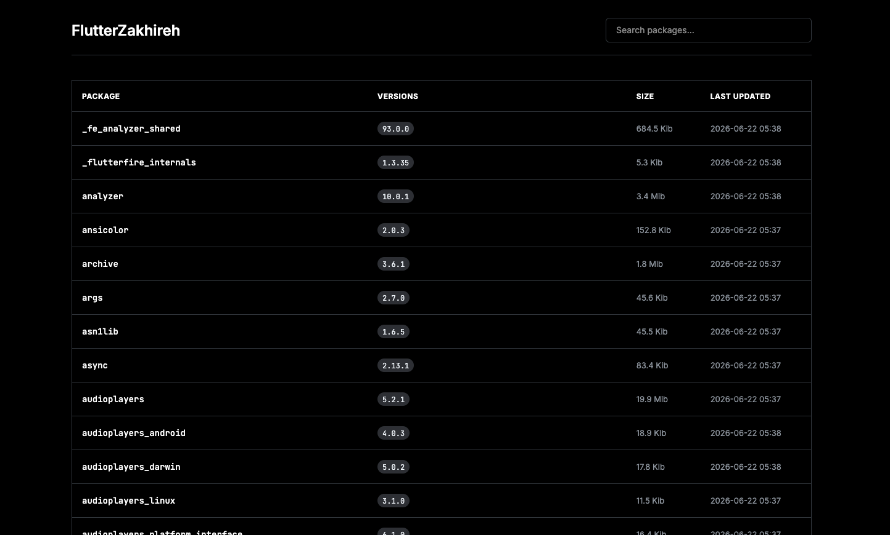

```text
    ________      __  __               _____         __   __    _           __  
   / ____/ /_  __/ /_/ /____  _____   /__  /  ____ _/ /__/ /_  (_)_______  / /_ 
  / /_  / / / / / __/ __/ _ \/ ___/     / /  / __ `/ //_/ __ \/ / ___/ _ \/ __ \
 / __/ / / /_/ / /_/ /_/  __/ /        / /__/ /_/ / ,< / / / / / /  /  __/ / / /
/_/   /_/\__,_/\__/\__/\___/_/        /____/\__,_/_/|_/_/ /_/_/_/   \___/_/ /_/ 
```

FlutterZakhireh is a robust, local Flutter package proxy designed for teams working in air-gapped or restricted environments. It caches packages locally and serves them to developers, ensuring reliable builds even when the upstream internet is unstable or inaccessible.

---

## [.] Features

*   **Offline Mode**: Serves cached packages without internet access.
*   **Package Upload**: Supports manual upload of private packages (`.tar.gz`, `.json`).
*   **Spec Management**: Upload POP Spec YAML files from the dashboard; Parity prepares an example project, resolves dependencies through this proxy, and records generation results — no repository access required.
*   **Dashboard**: Minimal Web UI to view cached packages, sizes, and versions.
*   **Private Packages**: Support for `FLUTTER_NO_SUMDB` and allow/deny lists.

**[Read the complete How-To Guide](HOWTO.md)** for detailed setup and usage instructions.

---

## [.] Dashboard



*The minimalist dashboard provides a clear overview of your cached packages.*

---

## [.] Getting Started

### Running Locally

1.  **Start the server:**
    ```bash
    go run ./cmd/server
    ```
    The server listens on `:8811` by default.

    

2.  **Configure your Flutter environment:**
    Point `pub` at the proxy with the `PUB_HOSTED_URL` environment variable:
    ```bash
    export PUB_HOSTED_URL=http://localhost:8811
    ```

3.  **Download packages:**
    Simply run `flutter pub get` in your projects. FlutterZakhireh fetches
    packages from `pub.dev` on first request, **rewrites their archive URLs to
    point back at the proxy**, caches them to disk, and serves them from the
    cache on every subsequent request.

4.  **View Dashboard:**
    Open [http://localhost:8811](http://localhost:8811) in your browser.

### Running with Docker

```bash
docker-compose up -d
```
This will start FlutterZakhireh and mount `./data/packages` for persistence.

---

## [.] Configuration

Configuration is managed via environment variables:

| Variable | Default | Description |
|:---|:---|:---|
| `FLUTTERZAKHIREH_PORT` | `:8811` | Port to listen on. |
| `FLUTTERZAKHIREH_DATA_DIR` | `./data/packages` | Directory to store cached packages. |
| `FLUTTERZAKHIREH_UPSTREAM` | `https://pub.dev` | Upstream proxy URL. |
| `FLUTTER_NO_SUMDB` | (empty) | Comma-separated glob patterns for private packages. |
| `FLUTTERZAKHIREH_ALLOW` | (empty) | Comma-separated list of allowed package patterns. |
| `FLUTTERZAKHIREH_DENY` | (empty) | Comma-separated list of denied package patterns. |
| `FLUTTERZAKHIREH_SPECS_DIR` | `./data/specs` | Directory for uploaded specs and their workspaces, outputs, and logs. |
| `FLUTTERZAKHIREH_SPEC_MAX_UPLOAD_BYTES` | `1048576` | Max uploaded spec file size in bytes (1 MiB). |
| `FLUTTERZAKHIREH_MAX_JOBS` | `2` | Max concurrent spec generation jobs. |
| `FLUTTERZAKHIREH_JOB_TIMEOUT` | `10m` | Timeout per generation run (e.g. `5m`, `30s`). |
| `FLUTTERZAKHIREH_FLUTTER_BIN` | (auto: `flutter`, then `dart`) | Binary used for dependency resolution. |

---

## [.] Specification Management (Parity Workflow)

Upload a POP Spec YAML file from the dashboard (**Specifications** tab) or via
the API. The backend validates it, stores it under `FLUTTERZAKHIREH_SPECS_DIR`,
generates an example project from it, runs `flutter pub get` with
`PUB_HOSTED_URL` pointed back at this proxy (the same mechanism as
`scripts/prime_cache.sh`), and records packages, logs, and outputs. No GitHub
or repository credentials are ever required.

Minimal POP Spec format (project-specific, not OpenAPI):

```yaml
name: my_app
version: 1.0.0
dependencies:
  http: ^1.1.0
  provider: ^6.0.5
dev_dependencies:
  flutter_lints: ^3.0.0
```

`name` and at least one of `dependencies` / `dev_dependencies` are required.
Uploads are limited to `.yaml` / `.yml`, validated server-side, and identified
by SHA-256 content hash: identical content is never regenerated while its
outputs are valid; changed content under the same `name` becomes a new version
(marked `stale` until it succeeds); a failed update never destroys the last
good output (staging + atomic promotion).

Storage layout (`FLUTTERZAKHIREH_SPECS_DIR`, survives restarts):

```text
<spec-id>/source.yaml  latest upload
<spec-id>/metadata.json  persistent record (status, runs, timestamps)
<spec-id>/versions/<sha>.yaml  immutable version history
<spec-id>/workspace/  generated example project
<spec-id>/outputs/  last successful output (pubspec.lock, generation.json)
<spec-id>/logs/<run>.log  captured process output
```

API endpoints (JSON; multipart field `spec` for uploads):

```text
POST   /api/specs                        201 created / 200 deduped / 409 in progress / 400 invalid
GET    /api/specs                        list + counts
GET    /api/specs/{id}                   details (stale flag, runs, output)
GET    /api/specs/{id}/status            lightweight polling status
GET    /api/specs/{id}/source            download stored YAML
GET    /api/specs/{id}/logs[?run=]       run log (latest by default)
POST   /api/specs/{id}/retry             202 re-queued / 409 already running
DELETE /api/specs/{id}                   204 (cancels jobs, removes only its own files)
GET    /api/specs/{id}/outputs           output metadata
GET    /api/specs/{id}/outputs/download  outputs as .tar.gz
```

> **Note (Docker):** the stock image contains no Flutter/Dart SDK, so
> generation jobs fail with an actionable "install the SDK" error unless you
> mount one and set `FLUTTERZAKHIREH_FLUTTER_BIN`. Spec upload, listing,
> retry, and deletion work regardless.

---

## [.] Testing & Maintenance

### Testing
Run unit tests:
```bash
go test ./...
```

Run integration tests (requires server running):
```bash
./scripts/integration_test.sh
```

### Cleanup
To remove all cached data and logs:
```bash
./scripts/cleanup.sh
```

### Prime Cache
To pre-populate cache with popular Flutter packages:
```bash
./scripts/prime_cache.sh
```

---

## [.] Usage with Flutter Apps

```bash
export PUB_HOSTED_URL=http://localhost:8811
flutter clean
flutter pub get
```

The first `flutter pub get` populates the cache; subsequent runs (including by
other developers, or with the network disconnected) are served from cache.

> **Important:** Use `PUB_HOSTED_URL` to point `pub` at the proxy.
> Do **not** use `https_proxy` — FlutterZakhireh is a reverse proxy (origin
> server), not a forward CONNECT proxy. `https_proxy` would try to tunnel
> HTTPS traffic through the server, which is not supported.

---

## [.] License

MIT

<!-- 
ASCII ART GENERATION
====================
Regenerate these banners using the following commands:

- Project Banner: figlet -w 450 -f ~/codes/ANSI_Shadow.flf "Flutter Zakhireh"
- Section Headers: figlet -f slant "Text Here"

Preserved for maintenance/regeneration of the documentation aesthetics.
-->
